# Timeless 前端概念稿（首页 + 二级页面）

这是一套**独立的前端概念稿**：首页 + 5 个二级页面，用来和现在的 `index.html`、文章页、归档页、登录页、词库和账本做对比。没有改动 `app.py`、`index.html`、`styles.css`，也没有接数据库。

> 二级页面的详细说明和接回步骤在 [pages/README.md](pages/README.md)。

先看对比（左：现在，右：这版概念稿）：

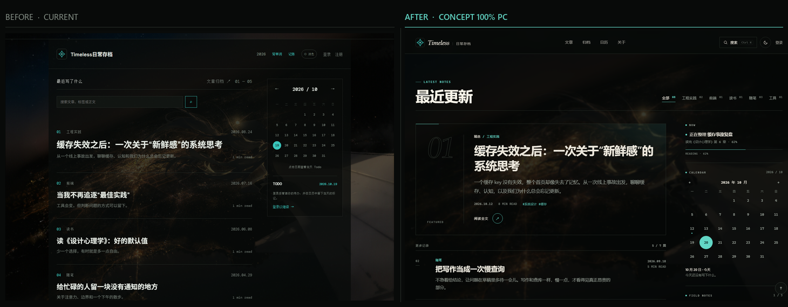

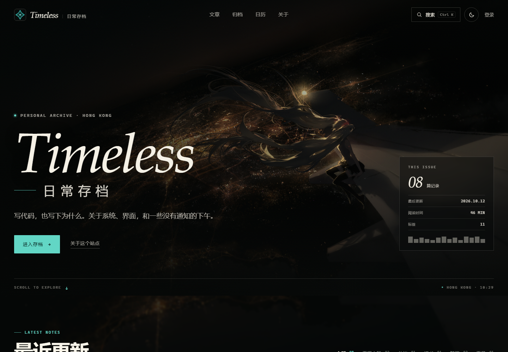

## 先看这里

- 本机预览：<http://127.0.0.1:8138/demo/>
- 也可以直接打开 `demo/index.html`；用 HTTP 打开时 `localStorage`（主题、Todo）更稳定。
- 自己启动静态服务：

```powershell
# 在项目根目录
python -m http.server 8138
# 然后打开 http://127.0.0.1:8138/demo/
```

文件：

```text
demo/
  index.html      首页骨架 + 静态精选文章
  demo.css        首页基础样式，无外部字体
  home-texture.css 首页照片透出层（固定照片 + 轻柔化/压暗）
  home-pc.css     只作用于 PC（>=1280）的首页缩放
  demo.js         首页文章数据、筛选、搜索、日历、Todo、主题
  pages/          二级页面：article / archive / login / words / money
    shared.css    页面 cover、breadcrumb、page main
    shared.js     主题、固定 header、toast、全局快捷键
    data.js       归档、词库、账本的 demo 数据
    *.css / *.js  每页自己的布局与交互
    README.md     二级页面的设计说明、截图和接回步骤
  screenshots/    桌面 / 移动 / 明暗 / before-after 截图
```

## 二级页面

从首页的导航、文章卡片、页脚都可以进去：

| 页面 | 入口 |
| --- | --- |
| 文章详情 | [pages/article.html](pages/article.html) |
| 文章归档 | [pages/archive.html](pages/archive.html) |
| 登录 / 注册 | [pages/login.html](pages/login.html) |
| 背单词 | [pages/words.html](pages/words.html) |
| 日常账本 | [pages/money.html](pages/money.html) |

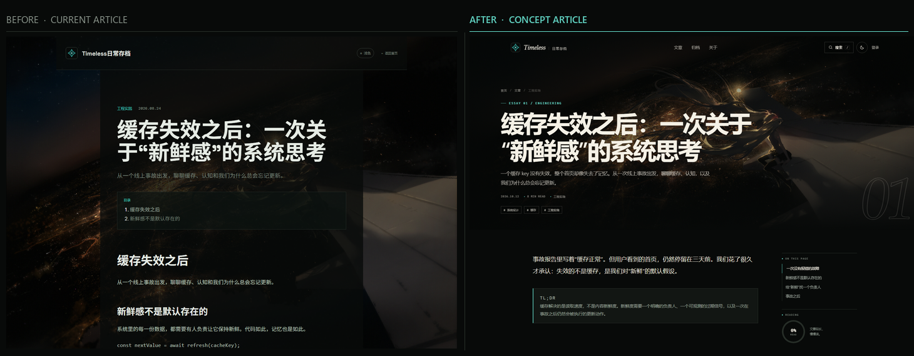

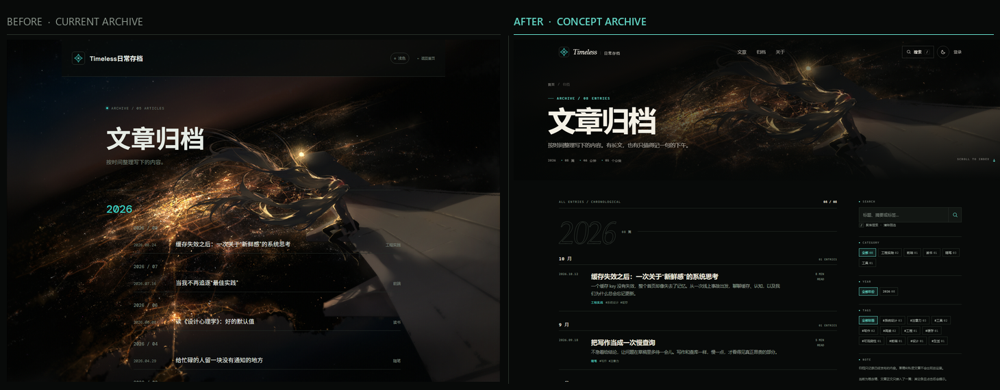

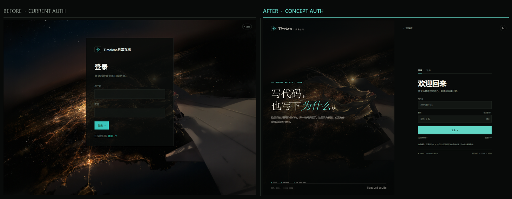

## 为什么做这一版

现有的前端不是“做得差”。它有自己的气质：夜航照片、`Timeless` 的衬线斜体、编号文章列表、青色点缀，都很有辨识度。问题主要出在**读**这件事上：

1. **正文压在照片上。** 内容区只有约 78% 的黑底，城市高光会直接透出来；muted 文字在亮部掉对比，长文章会更明显。demo 保留了照片透出，但先把照片固定、柔化、压暗，再让内容面板半透明，避免高光直接抢字。
2. **首屏 100svh 把内容藏起来。** 每次访问都要先滚过一整屏照片，底部的 scroll cue 又很小；对回访读者不够友好。
3. **信息层级偏平。** 年份、背单词、记账、主题、登录、注册在 header 里几乎同一重量；文章列表里每一条也几乎一样重，缺少“这一期先读哪篇”的引导。
4. **搜索是内联输入框。** 没有键盘路径、空结果状态、结果高亮；输入时只换列表，反馈比较弱。
5. **字体依赖 Google。** Manrope、Space Grotesk、Noto Sans SC 都从 `fonts.googleapis.com` 加载，服务器又在阿里云，首屏字体会受网络影响。
6. **移动端比较挤。** header 的工具会换行，文章 meta 会贴到右边，hero 仍然占满一屏；浅色主题则把照片完全洗掉，品牌感变弱。

二级页面的问题更明显：

- **文章详情 / 归档**：正文和时间线仍然直接压在夜航照片上，文章页的标题在移动端会贴边；目录、阅读进度和筛选是有的，但视觉上没有把“读”放在第一位。
- **登录 / 注册**：是一张浮在照片上的居中卡片，缺少登录/注册切换、字段错误、密码显隐和成功态。
- **背单词 / 账本**：功能在，但页面层级比较平；词库没有把“先回忆再核对”做成一个专注的流程，账本的空状态也看不出它真正能做什么。

## 新版做了什么

- **首屏 84svh**：内容在首屏底部露出一点，固定 header 在滚动后变为实底；hero 底部保留滚动提示和香港时间。
- **上下叠字的品牌 lockup**：`Timeless` 大字衬线斜体 + `日常存档` 小字宽字距，左侧加了更明确的 scrim，右侧是像登机牌一样的“本期概览”。
- **阅读优先的内容区**：文章区不再用纯黑实底；用固定照片 + 轻柔化/压暗 + 半透明面板，桌面标题 26px、摘要 15.8px，移动端另调；行高和颜色重新调过，精选文章是一块透明框，照片从中透出。
- **命令面板式搜索**：`Ctrl/⌘ K` 或 `/` 打开；按标题、摘要、分类、标签搜索；支持 ↑↓ 选择、↵ 定位、ESC 关闭；结果会显示命中的分类/标签。
- **可用的筛选与定位**：分类筛选、标签筛选、清除筛选、显示更多；点日历里有圆点的日期，可以直接跳到对应文章并闪一下。
- **Todo 和主题**：Todo 存在 `localStorage`，增删改查都能用；主题在“夜航 / 日间”之间切换，日间模式是暖纸色，hero 仍然保持深色，品牌不断裂。
- **重新组织了页脚与关于区**：工具链接退到 footer，正文优先级更高；加了一个短小的 About，交代站点是什么、用什么写的。
- **去掉外部字体依赖**：改用系统字体栈（Segoe UI / 苹方 / 微软雅黑 + Georgia / 宋体 + Cascadia Mono），不额外发网络请求。
- **移动端重新排过**：320–1440 都测了，没有横向溢出；390px 下六个分类刚好排下，更窄时横向滑动并带渐隐提示；移动端搜索是全屏的。
- **二级页面**：文章详情改成“封面 + 不透明阅读页 + sticky 目录/进度”；归档改成可搜索的年份/月份时间线；登录/注册改成左右分屏 + 表单状态；词库改成专注学习卡 + 评级 + 快捷键 + 词库浏览；账本补了示例数据、月份切换、汇总、明细、记一笔、支出构成和 CSV 导出。细节见 [pages/README.md](pages/README.md)。

## PC 端缩放调整

上一版在 1440 / 1920 的 PC 上需要浏览器缩放到 120% 才觉得舒服。这次只针对 **PC（>=1280）** 把首页整体放大约 18%，并把原本居中的 1240 拉到接近满宽：

- 内容宽度：1240 → 1360 @ 1440，最大 1480
- 正文：标题 22 → 26，摘要 13.4 → 15.8
- 区块标题：46 → 54
- header：72 → 84
- sidebar：300 → 360
- 搜索面板：680 → 800
- 页面左右边距：1440 下从 100px 收到 40px

左：旧版在 120% 缩放下的参考；右：新版 100% PC（已切成照片透出）。尺寸基本对齐：

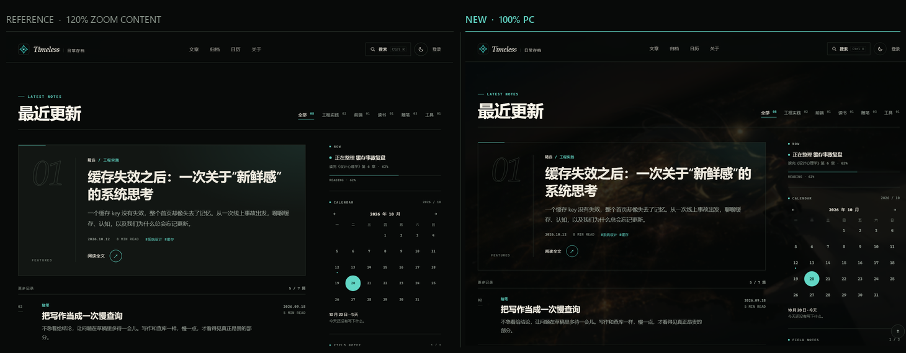

这些规则只在 [home-pc.css](home-pc.css) 里，且只在首页加载；移动端不变。**二级页面暂时还没有套用这个尺寸**，等你先确认首页这一版。

## 照片透出

按你的偏好，首页从实底改回了照片透出：

- 照片固定在页面背后，轻微柔化、压暗，滚动时不会跟着内容跑；hero 仍然是清晰原图，正文后面是同一张图的柔化版，形成一点景深。
- 文章列表、精选框、About 区都不再用纯黑面板；精选框几乎是透明的，照片会从标题、摘要和右侧日历后面透出来。
- 不是把正文直接放回最亮的高光上：照片层先压暗，内容层再透明；对比度还在。
- 左：上一版实底；右：现在照片透出：

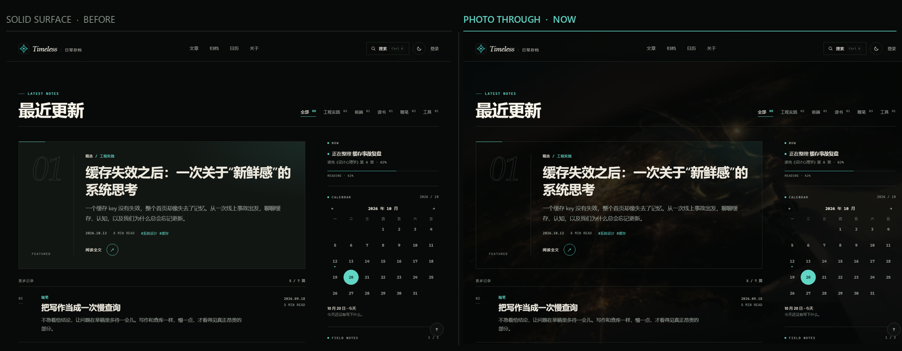

规则在 [home-texture.css](home-texture.css)，只由首页加载；移动端也生效。如果还想让照片更明显，可以再降压暗或减少柔化；如果觉得抢字，就往回收一点。

## 和现在首页的对比

| | 现在 | 这个 demo |
| --- | --- | --- |
| 首屏 | 100svh，纯 landing | 84svh，内容露出，固定 header |
| 正文背景 | 照片 + 78% 黑底 | 固定照片 + 轻柔化/压暗 + 半透明面板，照片透出 |
| 品牌 | `Timeless日常存档` 一行 | 上下叠字，separator + tracking |
| 搜索 | 内联 input，输入即请求 | 命令面板，键盘导航，标签命中 |
| 文章层级 | 精选只比普通卡片大一点 | 独立精选面板 + “更多记录”列表 |
| 日历 / Todo | 侧栏，服务端局部刷新 | 同位置，demo 用 localStorage |
| 浅色主题 | 白底 + 照片被洗掉 | 暖纸色内容 + 深色 hero |
| 字体 | Google Fonts | 系统字体，无外部请求 |
| 移动端 | 工具换行，meta 贴边 | 单列，6 个筛选刚好放下，搜索全屏 |

## 交互清单

- `Ctrl K` / `⌘ K` / `/`：打开搜索
- 搜索框内 `↑` `↓`：选择结果；`↵`：定位文章；`ESC`：关闭
- 分类按钮：筛选；再次点“全部”恢复
- 标签：筛选；再点一次取消
- 日历：点有圆点的日期；点下面的文章标题跳到文章
- Todo：勾选、删除、添加；刷新后保留
- 右上角太阳/月亮：切换日间 / 夜航
- “显示更多记录”：展开剩余文章
- 首页的《缓存失效之后》会进入文章详情；其它文章在首页会定位并提示，在归档里可以看全部条目
- 登录 / 注册、背单词、账本、归档的 demo 行为见 [pages/README.md](pages/README.md)

## 截图

| 桌面 · 夜航 | 桌面 · 日间 |
| --- | --- |
| 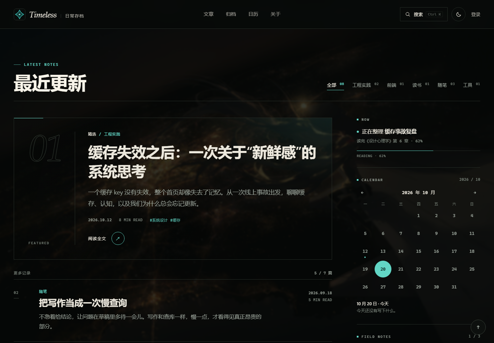 | 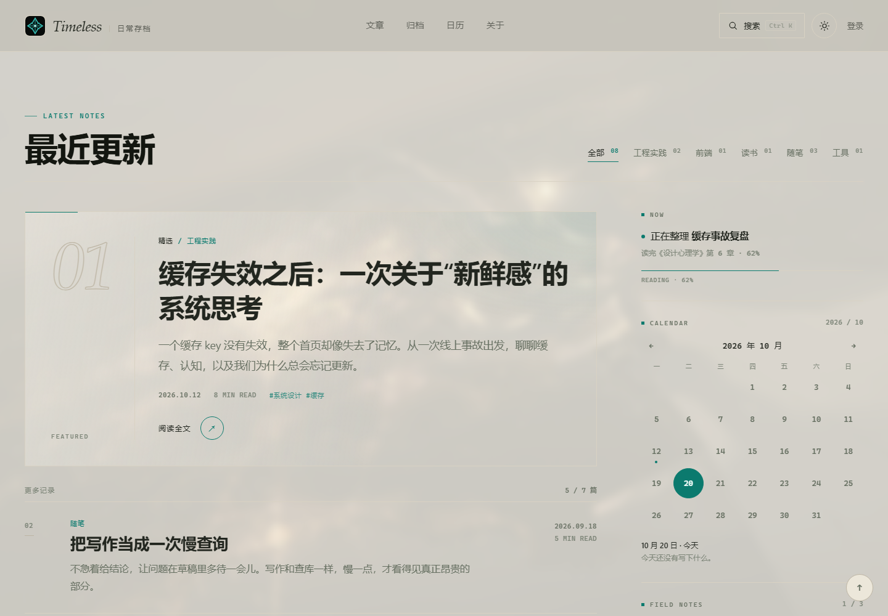 |

| 搜索 | 移动端 |
| --- | --- |
| 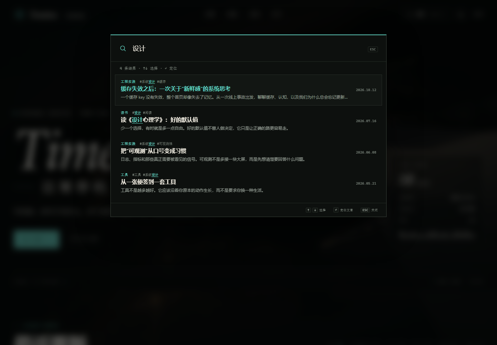 | 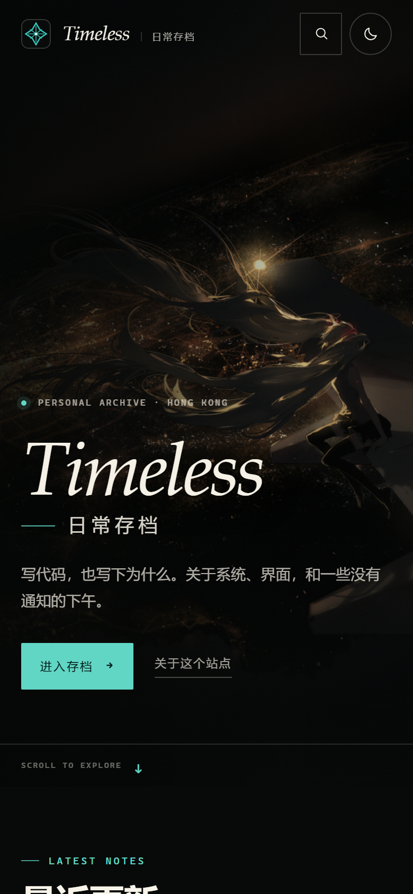 |

完整长图：[screenshots/09-full-page.png](screenshots/09-full-page.png)

## 接回真实站点时

这个 demo 故意只做前端，接回时建议保留现有 Python 的服务端渲染，不要把文章列表完全改成客户端渲染（SEO 和 no-JS 都会受影响）。

1. **文章列表**：保留 `app.py` 的 `render_article_card` / `<!-- ARTICLES_START -->` 机制，把 demo 的 `.feature` 和 `.post-row` 当作模板；服务端输出 HTML，JS 只负责筛选和交互。
2. **搜索**：继续用 `/search?q=`，把返回的 JSON `cards` 换成 demo 的搜索结果结构；如果 JS 不可用，保留原来的 form submit。
3. **日历 / Todo**：把 demo 里的本地状态替换成现有的 `/calendar/view`、`/todo/view`、`/todo/save`、`/todo/toggle`、`/todo/delete`，保留 `X-Requested-With` 和 CSRF。
4. **主题**：继续用 `data-theme`，在 `<head>` 里先读 `localStorage` 再渲染，避免闪白；主题 key 可以沿用 `timeless-theme`。
5. **字体**：如果舍不得 Manrope / Space Grotesk，建议自托管 woff2，不要继续依赖 Google Fonts；否则直接用系统字体栈即可。
6. **二级页面**：把 [pages/article.html](pages/article.html) 和 [pages/archive.html](pages/archive.html) 的结构转成 `app.py` 的服务端模板；文章正文继续由 Markdown 渲染，归档继续从 `articles` 分组。登录 / 词库 / 账本分别接回现有 `/login`、`/words`、`/money` 路由，具体见 [pages/README.md](pages/README.md)。
7. **后台**：这次没有重做；接入时把 CSS 变量、header、footer、按钮和 focus 样式带过去即可。
8. **资源**：继续用 `assets/background.jpg` 和 `assets/favicon.svg`；demo 通过 `../assets` 引用，放在项目根目录下即可。

## 验证

用 Playwright + Edge 跑过：

- 桌面 1440、平板 900、移动 390 / 360 / 320，均无横向溢出
- 搜索打开、输入、↑↓、ESC、空结果、建议词、点击结果
- 分类筛选、标签筛选、清除筛选、显示更多
- 日历选日期、从日历定位文章
- Todo 勾选 / 添加 / 删除 / 刷新持久化
- 主题切换 / 刷新持久化
- 二级页面：文章目录/进度/复制、归档搜索与筛选、登录注册校验与成功态、单词揭示/评分/完成/重启、账本增删/月份/分类/CSV
- 320 / 360 / 390 / 768 / 900 / 1024 / 1280 / 1366 / 1440 / 1600 / 1920 均无横向溢出
- PC 缩放：在 1280 / 1366 / 1440 / 1600 / 1920 下检查 100% 视图；1440 下与旧版 120% 缩放做并排对照
- 0 个 console error；所有 button 有可访问名称；所有 input 有 label

## 限制

- 文章、分类、标签是 demo 数据，不是从 `timeless.db` 读的；二级页面只有《缓存失效之后》一篇完整正文。
- 登录 / 注册是前端演示，不写数据库、不建立会话；词库只有 8 个示例词；账本是内存数据，刷新后恢复初始账本。
- Todo 只存在本地浏览器，没有 CSRF、没有账号同步。
- 列表是客户端渲染的；生产环境应保留服务端渲染。
- 背景图沿用现有素材；如果想换图，建议保留“暗部 + 低饱和高光”的特征，hero 文字才有足够对比。
- RSS、收藏、忘记密码等入口仍是 toast。
- PC 缩放只应用于首页（`home-pc.css`），二级页面暂时保持上一版尺寸。
- 照片透出只应用在首页；二级页面仍然是实底，等你确认首页这一版后再统一。

## 2026-10-20 Demo 改进

本次仅修改 demo，未部署到生产。`refinements.css` 统一跨页视觉细节，`navigation.js` 支持移动菜单关闭和键盘操作。

- 手机工具页使用紧凑封面，学习输入及记账入口提前出现；记账表单排在明细之前，支出构成仍保留。
- 移动菜单包含文章、归档、背单词、记账、关于及登录入口，并标明演示账号状态。
- 提高辅助字号及浅色主题灰字对比度；统一桌面导航、容器与控件比例，文章正文保留适宜阅读宽度。
- 首页精选区加强底色、缩小序号，保留背景照片氛围。
- 账本补充编辑、取消、删除确认和金额精度校验；单词评分移除虚构复习时间及已接入 FSRS 的承诺。
- Edge / Playwright 检查 6 页 × 5 种宽度（320、390、768、1024、1440）× 深浅主题共 60 组布局；无横向溢出、无页面脚本异常。另验证移动菜单及 Escape、单词揭示/评分、账本新增/编辑/取消/删除与金额精度。
- 新截图为 `screenshots/28-*` 至 `screenshots/30-*`；此前截图保留作历史对照。
