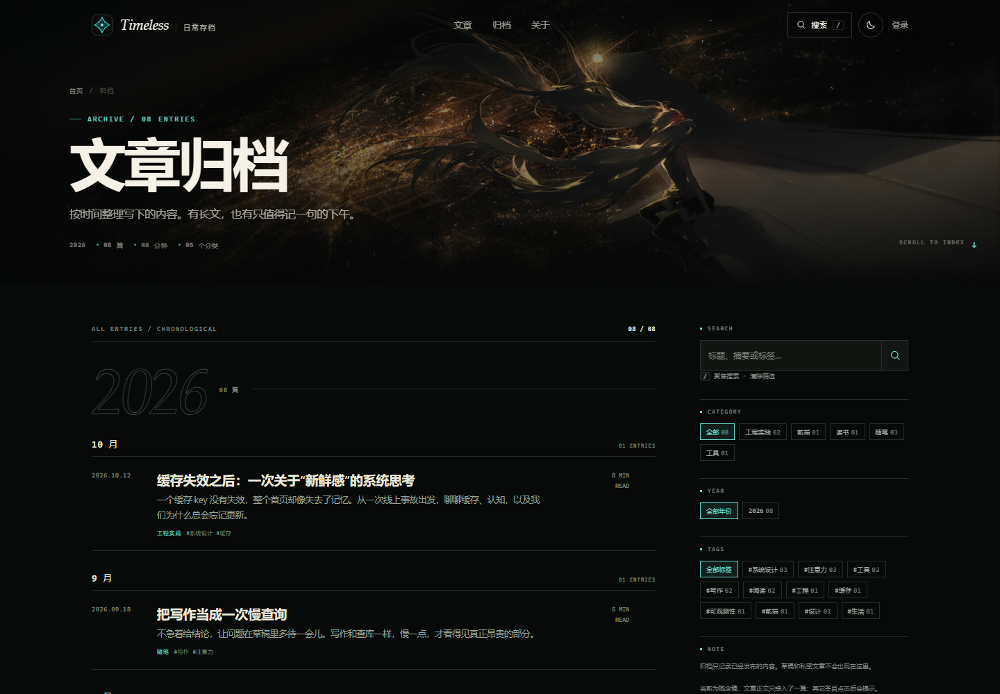
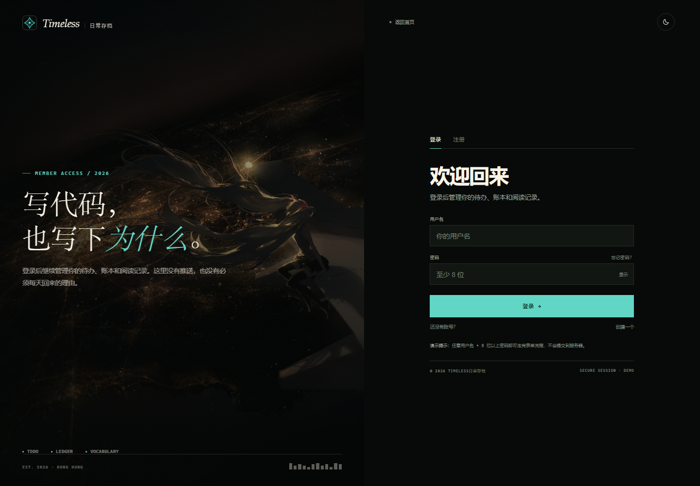
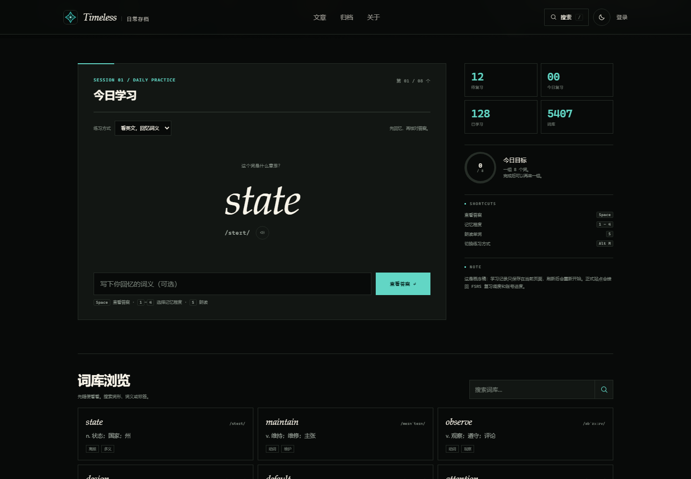
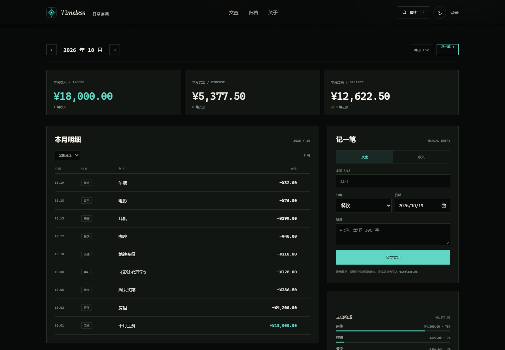
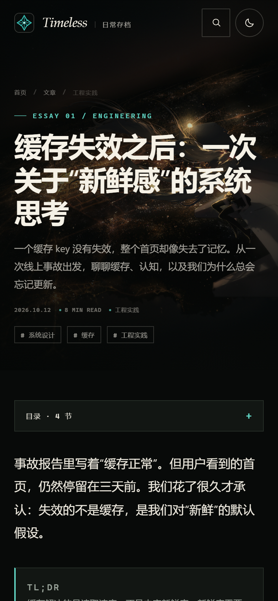

# 二级页面概念稿

这是首页 demo 的延续：把同一套视觉语言带到 5 个二级页面。没有改动现有的 `app.py`、`index.html`、`styles.css`，所有内容都是前端 demo 数据。

## 页面

| 页面 | 入口 | 这次解决什么 |
| --- | --- | --- |
| 文章详情 | [article.html](article.html) | 正文不再压在照片上；加 sticky 目录、阅读进度、代码/表格/引用、作者和相邻文章 |
| 文章归档 | [archive.html](archive.html) | 年份/月份时间线、搜索、分类/年份/标签筛选、计数，移动端把筛选收起来 |
| 登录 / 注册 | [login.html](login.html) | 从“浮在照片上的一张卡”改成左右分屏；登录/注册 tab、字段校验、密码显隐、成功态 |
| 背单词 | [words.html](words.html) | 把学习台做成一个专注卡片：进度、模式切换、答案揭示、四档记忆程度、快捷键、词库浏览 |
| 日常账本 | [money.html](money.html) | 有示例数据的月度账本：月份切换、收入/支出/结余、明细、记一笔、支出构成、CSV 导出 |

从 [首页 demo](../index.html) 的导航、文章卡片、页脚都可以点进这些页面。

## 共同的设计

- **深色封面 + 不透明内容页**：照片只留在页面顶部的 cover 区；正文和工具内容放在近不透明的 surface 上，先解决可读性。
- **固定 header**：滚动后变为实底；搜索入口统一指向归档搜索；`data-theme` 在 `<head>` 里先读，避免闪白。
- **同一套 tokens**：`../demo.css` 提供颜色、字体、header/footer/按钮/toast；`shared.css` 提供页面 cover、breadcrumb、page main；每个二级页只加载自己需要的一小份 CSS。
- **系统字体**：没有任何外部字体请求。
- **响应式**：320–1440 都测过；移动端没有横向溢出。
- **可访问性**：focus-visible、skip link、aria-label、表单 label、`prefers-reduced-motion`；所有 button 有可访问名称。
- **PC 缩放 / 照片透出**：首页的 `home-pc.css` 和 `home-texture.css` 只作用于 `demo/index.html`；这些二级页面暂时保持上一版尺寸和实底，等首页的比例与质感确认后再统一。

## 每页的交互

### 文章详情

- 顶部封面；标题按语义换行（不再把“关于”拆开）。
- 桌面：右侧 sticky 目录 + 阅读进度环；滚动时目录高亮。
- 移动：目录折叠成 `
`；正文 16px / 1.92。
- 复制代码、复制链接、返回归档；`reading-progress` 固定在最上面。
- 文章末尾有标签、作者卡、上一篇/下一篇。

### 归档

- 按年份/月份分组，月份有 count。
- 搜索（标题/摘要/分类/标签）、分类、年份、标签筛选；随时清除。
- 结果计数 `08 / 08`；空结果有独立状态。
- 移动端只保留搜索 + 分类，年份/标签/说明收起，时间线更早出现。
- 只有《缓存失效之后》有完整正文；其它条目点击会提示。

### 登录 / 注册

- 左边是夜航 cover + 站点宣言，右边是表单面板；移动端上下堆叠。
- 登录 / 注册 tab；注册表单支持可选邀请码。
- 空表单、密码太短、两次密码不一致都有字段级错误。
- 密码显示/隐藏；提交后 700ms 的 loading，再进入成功态。
- 成功态可以回到首页或“再试一次”。

### 背单词

- 会话：8 个词，`第 01 / 08 个` 和进度条。
- 模式：看英文回忆词义 / 看释义默写英文。
- `Space` 揭示答案；`1–4` 选择记忆程度；`S` 朗读；`Alt M` 切换模式。
- 四档：忘了 / 模糊 / 记得 / 熟练，仅演示自评交互，不计算下次复习时间。正式站目前使用基础间隔规则，尚未接入 FSRS。
- 完成态有 reviewed / remembered / minutes；可以再来一组。
- 右侧有今日目标环、待复习/今日复习/已学习/词库；下方词库可以搜索。

### 日常账本

- 2026 年 10 月有示例数据；上/下个月可以切换。
- 收入、支出、结余随月份重算；分类筛选只作用于明细。
- 记一笔：支出/收入、金额、分类、日期、备注；前端校验、即时更新。
- 支持编辑、取消编辑和删除确认；修改后同步更新汇总、分类筛选和支出构成，金额最多两位小数。
- 导出当前月份的 CSV（带 BOM，备注做公式前缀转义）。

## 截图

| 文章详情 · 桌面 | 归档 · 桌面 |
| --- | --- |
|  |  |

| 登录 / 注册 | 背单词 |
| --- | --- |
|  |  |

| 账本 | 文章移动端 |
| --- | --- |
|  |  |

归档、登录的 before/after：

## 接回真实站点

建议保留 Python 的服务端渲染，把 demo 当模板，而不是把整个站点改成 SPA。

1. **文章详情**：继续由 `app.py` 的 Markdown 渲染输出正文；把 `.prose` 包在 demo 的 reading layout 里。目录可以由服务端生成标题锚点，也可以像现在这样由前端扫 `h2`；阅读进度保持纯 JS。代码块的“复制”按钮是渐进增强。
2. **归档**：服务端按年月分组输出，保留现有 `/archive` 路由和 `posts` 数据；搜索/筛选可以先做前端过滤，数据量大时再走 `/search` 或查询参数。
3. **登录 / 注册**：把 demo 表单的 `method="post"`、`action="/login"` / `/register` 接回现有处理；保留 CSRF/邀请码/注册开关的错误回显。demo 的 `novalidate` 只是为了让前端校验可见，接回时应同时保留服务端校验。
4. **背单词**：接回 `/words/api/today` 和 `/words/api/review`；四档 rating 按现有基础间隔规则处理，预计复习时间及统计从服务端返回；不能把 demo 的自评说明当作调度结果。demo 里的 8 个词只用于展示，FSRS 是另行评估的后续功能。
5. **账本**：接回 `/money/save`、`/money/delete`、CSRF、月份与分类筛选；CSV 继续由服务端导出。demo 的示例数据刷新后重置，生产环境不要这样做。
6. **共享**：主题 key 可以沿用 `timeless-theme`；字体建议自托管，或继续用系统字体栈；背景图和 favicon 继续用 `assets/`。

## 验证

- Playwright + Edge：文章、归档、登录、背单词、账本五页。
- 搜索/筛选/清除、文章跳转、日历/归档计数、登录注册校验与成功态、单词揭示/评分/完成/重启、账本增删/月份/分类/CSV。
- 320 / 360 / 390 / 768 / 900 / 1024 / 1440 无横向溢出。
- 0 个 console error；所有 button 有可访问名称；所有 input/select/textarea 有 label。
- 移动端目录、移动端归档筛选、移动端学习卡、移动端账本逐页检查。

## 限制

- 文章只有《缓存失效之后》一篇完整正文；其它归档条目点击是提示。
- 登录 / 注册是前端演示，不写数据库、不建立会话。
- 背单词只有 8 个示例词，无复习调度和持久化；刷新会重置。
- 账本是内存数据 + 示例种子；刷新后恢复初始账本。
- 归档/首页的搜索是 demo 逻辑，不是对 `timeless.db` 的真实查询。
